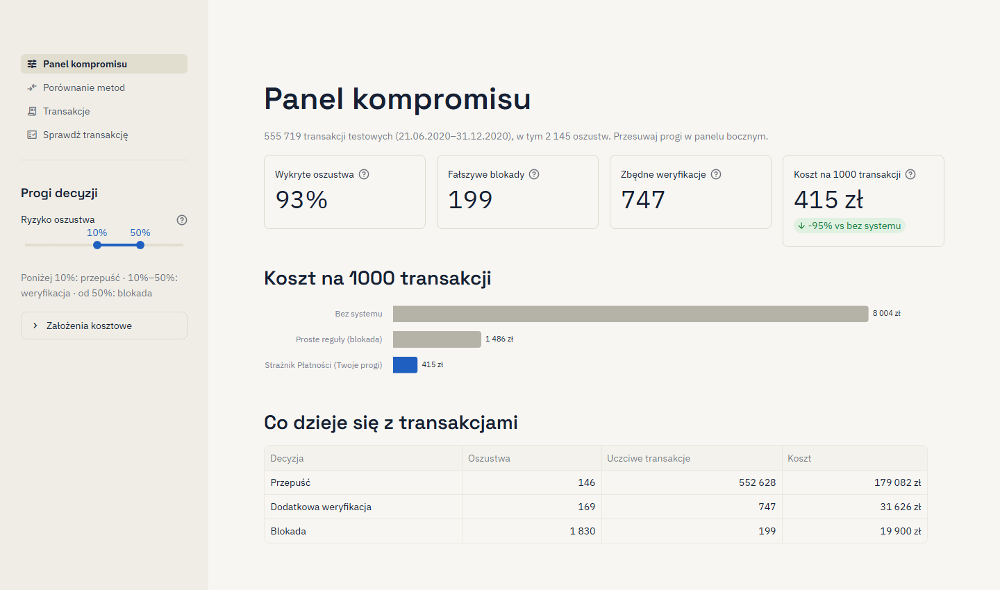
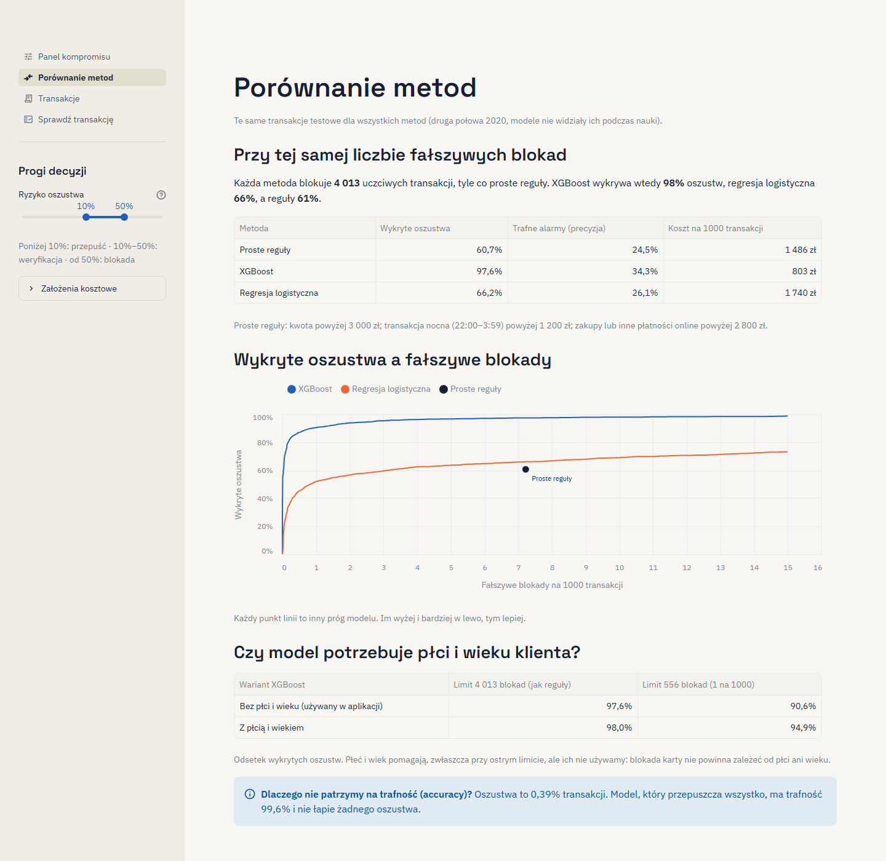
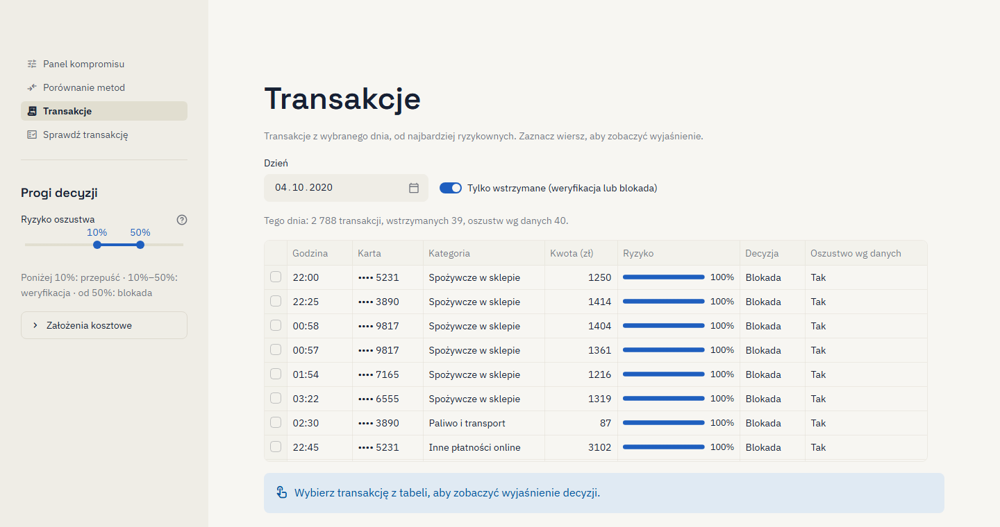
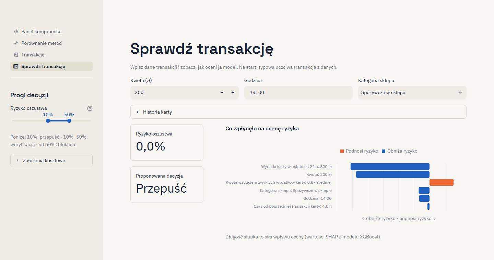

# Jak korzystać ze Strażnika Płatności

Strażnik Płatności ocenia ryzyko oszustwa w transakcjach kartowych i proponuje jedną z trzech decyzji:
**przepuść**, **dodatkowa weryfikacja** (SMS, 3D Secure) albo **blokada**. Pokazuje też, ile kosztuje
wybrany kompromis między złapanymi oszustwami a zatrzymanymi uczciwymi klientami.

Aplikacja działa na 555 719 transakcjach testowych z drugiej połowy 2020 roku (dane syntetyczne z Kaggle).
Jak ją uruchomić, opisuje [README](../README.md). Liczby w tym tutorialu dotyczą ustawień domyślnych.

## Panel boczny: progi decyzji

Najważniejszy element całej aplikacji to suwak **Ryzyko oszustwa** z dwoma uchwytami:

- poniżej pierwszego progu transakcja **przechodzi**,
- między progami klient musi ją **potwierdzić** (weryfikacja),
- od drugiego progu transakcja jest **blokowana**.

Domyślnie: weryfikacja od 10%, blokada od 50%. Progi działają na wszystkich ekranach.
Skala suwaka jest gęstsza przy niskim ryzyku, bo tam jest prawie każda transakcja.

Pod suwakiem jest zwinięta sekcja **Założenia kosztowe**: koszt zablokowania uczciwej transakcji (100 zł),
koszt jednej weryfikacji (5 zł) i skuteczność weryfikacji (90%). To nasze założenia, nie dane rynkowe.
Zmieniają tylko wyliczenia kosztów.

## 1. Panel kompromisu

Cztery kafelki na górze odpowiadają na pytanie „co dają moje progi?”:

| Kafelek | Co znaczy | Domyślnie |
|---|---|---|
| Wykryte oszustwa | Odsetek oszustw skierowanych do weryfikacji lub zablokowanych | 93% |
| Fałszywe blokady | Uczciwe transakcje zablokowane przez system | 199 |
| Zbędne weryfikacje | Uczciwe transakcje, które klient musiał potwierdzić | 747 |
| Koszt na 1000 transakcji | Przepuszczone oszustwa + blokady + weryfikacje | 415 zł (−95% wobec braku systemu) |

Wykres pod kafelkami porównuje koszt z dwoma punktami odniesienia: brakiem systemu (8 004 zł) i prostymi
regułami (1 486 zł). Tabela „Co dzieje się z transakcjami” rozbija wynik na trzy decyzje.

**Spróbuj:**

1. Przesuń próg blokady z 50% na 20%. Fałszywych blokad przybywa (199 → 539), a wykrytych oszustw jest
   tyle samo (93%), bo te transakcje i tak trafiały do weryfikacji. Ostrzejsza blokada uderza tu głównie
   w uczciwych klientów.
2. Wróć do 50% i przesuń próg weryfikacji z 10% na 0,5%. Koszt spada do 219 zł i wykrywamy 98% oszustw,
   ale zbędnych weryfikacji jest już 5 496. Najtańsze ustawienie nie musi być najlepsze dla klientów.
3. Rozwiń „Założenia kosztowe” i zmień koszt blokady na 300 zł. Koszt przy domyślnych progach rośnie
   z 415 do 487 zł. Najlepsze progi zależą od tego, ile naprawdę kosztuje zablokowany klient.

## 2. Porównanie metod

Ten ekran odpowiada na pytanie „po co model, skoro są proste reguły?”. Każda metoda blokuje tyle samo
uczciwych transakcji co proste reguły (4 013), a porównujemy, ile oszustw przy tym łapie:

- proste reguły: 61%,
- regresja logistyczna: 66%,
- XGBoost: 98%.

**Jak czytać wykres:** każdy punkt linii to inny próg modelu. Oś pozioma to fałszywe blokady na 1000 transakcji,
pionowa to wykryte oszustwa. Im wyżej i bardziej w lewo, tym lepiej. Linia XGBoost jest wyżej przy każdej
liczbie fałszywych blokad.

Tabela „Czy model potrzebuje płci i wieku klienta?” pokazuje, że te cechy poprawiają wynik, zwłaszcza przy
ostrym limicie blokad (94,9% zamiast 90,6%). Mimo to aplikacja ich nie używa: decyzja o zablokowaniu karty
nie powinna zależeć od płci ani wieku.

## 3. Transakcje

Lista transakcji z jednego dnia, od najbardziej ryzykownych. Domyślnie pokazuje 4 października 2020, czyli dzień
z największą liczbą oszustw (40 na 2 788 transakcji), i tylko transakcje wstrzymane (weryfikacja lub blokada).

Kolumna **Oszustwo wg danych** to prawdziwa etykieta ze zbioru testowego. W banku nikt by jej nie znał,
tutaj pozwala sprawdzić, czy model trafia.

**Spróbuj:**

1. Zaznacz pierwszy wiersz (22:00, zakupy spożywcze, 1 250 zł, ryzyko 100%). Pod tabelą pojawi się
   wyjaśnienie: najmocniej podniosły ryzyko kwota, kategoria sklepu i wydatki karty w ostatnich 24 h (7 308 zł).
   Pomarańczowe słupki podnoszą ryzyko, niebieskie je obniżają.
2. Wyłącz „Tylko wstrzymane” i posortuj tabelę po kolumnie „Oszustwo wg danych” (kliknij nagłówek).
   Znajdziesz dwa oszustwa, które model przepuścił, oba z ryzykiem ok. 4%. Żaden model nie łapie wszystkiego.

## 4. Sprawdź transakcję

Tu wpisujesz własną transakcję i od razu widzisz ryzyko, decyzję i wyjaśnienie. Na start formularz zawiera
typową uczciwą transakcję: 200 zł o 14:00 w sklepie spożywczym (ryzyko 0%). Sekcja **Historia karty** opisuje,
jak karta była używana wcześniej: średnią kwotę (250 zł), wydatki w ostatnich 24 h (800 zł) i czas od poprzedniej
transakcji (4 h).

**Spróbuj po kolei:**

| Zmiana | Ryzyko | Decyzja |
|---|---|---|
| Kwota 3 000 zł, godzina 23:00, kategoria „Zakupy online”, w historii karty wydatki w 24 h: 4 000 zł | 62,5% | Blokada |
| To samo, ale godzina 14:00 | 23,7% | Weryfikacja |
| Z powrotem 23:00, ale wydatki w 24 h: 800 zł | 1,6% | Przepuść |

Wniosek: model najmocniej reaguje na serię wydatków w krótkim czasie i na porę nocną, a nie na samą
wysoką kwotę. Tak wyglądają oszustwa w tych danych.

**Ograniczenie modelu:** ustaw kategorię „Spożywcze w sklepie”, godzinę 23:00 i wydatki w 24 h 4 000 zł.
Przy kwocie 1 500 zł ryzyko wynosi 100%, a przy 20 000 zł tylko 80,7%. W danych uczących nie było oszustw
powyżej ok. 5 400 zł, więc model nie wie, że bardzo duża kwota też może być podejrzana. Model zna tylko sytuacje,
które widział w danych.

## Słowniczek

| Pojęcie | Znaczenie |
|---|---|
| Ryzyko oszustwa | Ocena modelu od 0 do 100%, jak bardzo transakcja przypomina oszustwa z danych |
| Wykryte oszustwa | Odsetek oszustw, które system zatrzymał lub skierował do weryfikacji |
| Fałszywa blokada | Uczciwa transakcja zablokowana przez system |
| Zbędna weryfikacja | Uczciwa transakcja, którą klient musiał dodatkowo potwierdzić |
| Trafne alarmy (precyzja) | Jaka część zablokowanych transakcji to faktycznie oszustwa |
| Proste reguły | Trzy reguły napisane ręcznie (np. kwota powyżej 3 000 zł), punkt odniesienia dla modeli |
| XGBoost | Model uczenia maszynowego zbudowany z wielu drzew decyzyjnych, używany w aplikacji |
| Regresja logistyczna | Prostszy model uczenia maszynowego, do porównania |
| SHAP | Metoda, która pokazuje, ile każda cecha transakcji dodała lub odjęła od oceny ryzyka |
