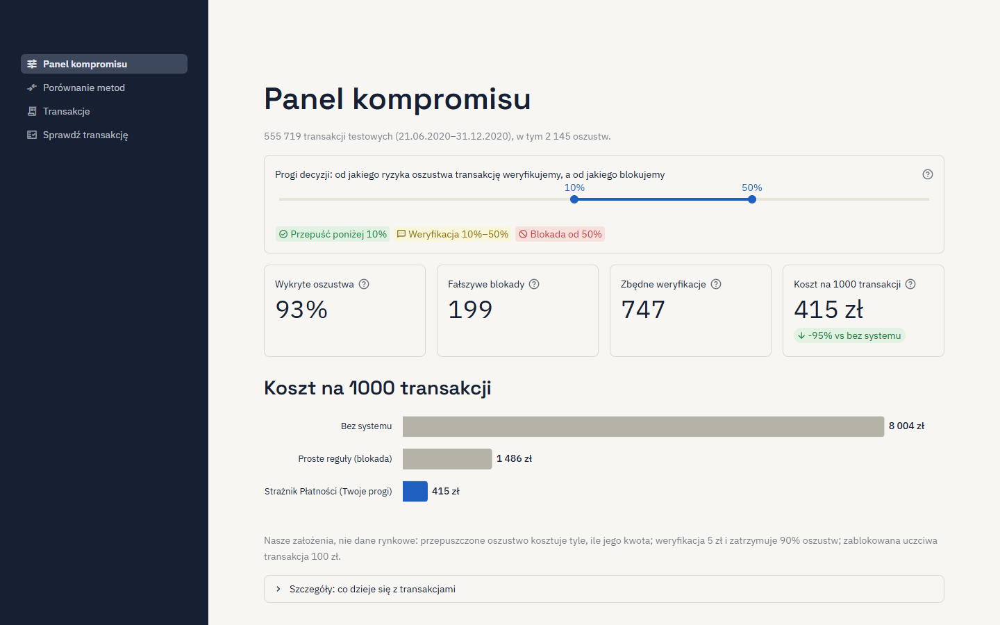
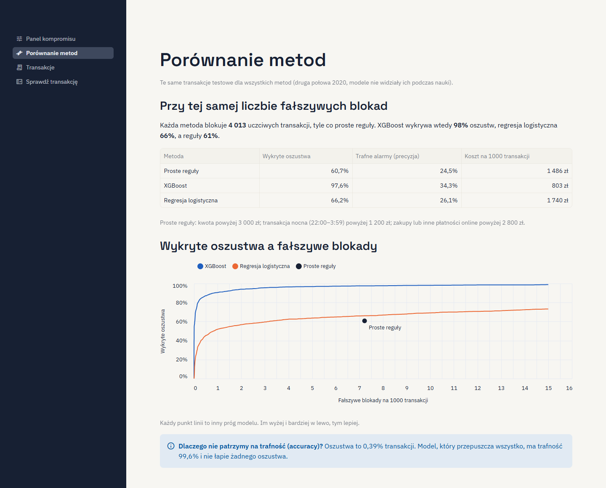
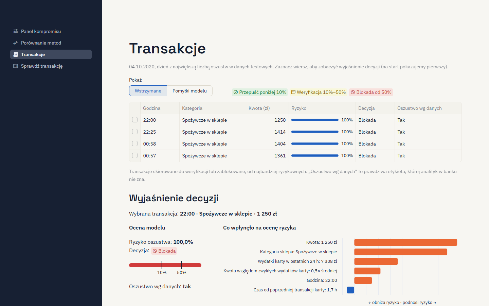
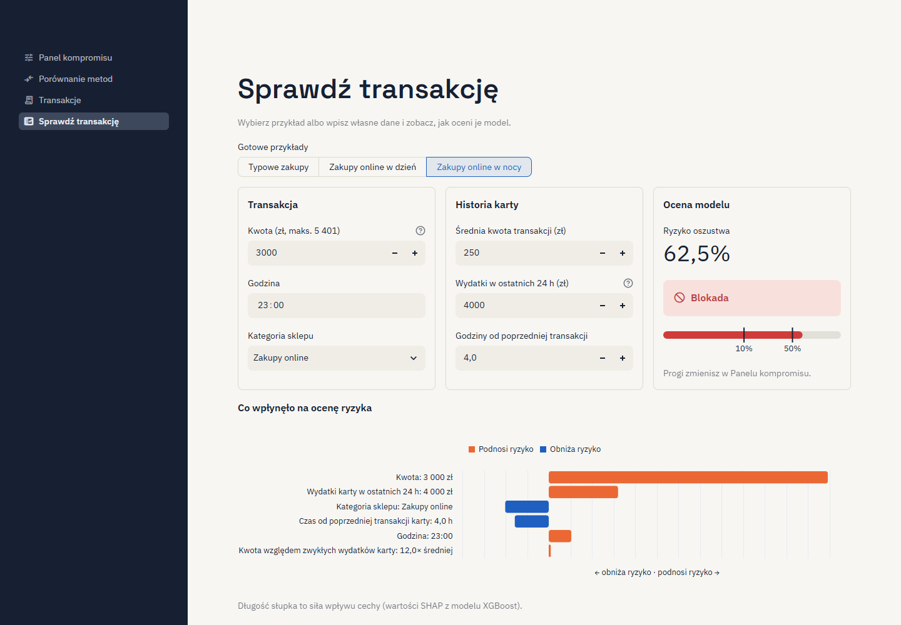

# Jak korzystać ze Strażnika Płatności

Strażnik Płatności ocenia ryzyko oszustwa w transakcjach kartowych i proponuje jedną z trzech decyzji:
**przepuść**, **dodatkowa weryfikacja** (SMS, 3D Secure) albo **blokada**. Pokazuje też, ile kosztuje
wybrany kompromis między złapanymi oszustwami a zatrzymanymi uczciwymi transakcjami.

Aplikacja działa na 555 719 transakcjach testowych z drugiej połowy 2020 roku (dane syntetyczne z Kaggle).
Jak ją uruchomić, opisuje [README](../README.md). Liczby w tym tutorialu dotyczą ustawień domyślnych.

Ekrany wybierasz w panelu bocznym, w kolejności, w jakiej najlepiej je oglądać.

## 1. Panel kompromisu

Najważniejszy element całej aplikacji to suwak **Progi decyzji** na górze panelu, z dwoma uchwytami:

- poniżej pierwszego progu transakcja **przechodzi**,
- między progami klient musi ją **potwierdzić** (weryfikacja),
- od drugiego progu transakcja jest **blokowana**.

Domyślnie: weryfikacja od 10%, blokada od 50%. Kolorowe etykiety pod suwakiem pokazują te trzy strefy.
Progi działają też na ekranach Transakcje i Sprawdź transakcję i zostają zapamiętane, gdy przechodzisz między
ekranami (odświeżenie strony przywraca domyślne). Skala suwaka jest gęstsza przy niskim ryzyku, bo tam jest
prawie każda transakcja.

Cztery kafelki pod suwakiem odpowiadają na pytanie „co dają moje progi?”:

| Kafelek | Co znaczy | Domyślnie |
|---|---|---|
| Wykryte oszustwa | Odsetek oszustw skierowanych do weryfikacji lub zablokowanych | 93% |
| Fałszywe blokady | Uczciwe transakcje zablokowane przez system | 199 |
| Zbędne weryfikacje | Uczciwe transakcje, które klient musiał potwierdzić | 747 |
| Koszt na 1000 transakcji | Oszustwa, które przeszły + blokady + weryfikacje, średnio na 1000 płatności | 415 zł (−95% wobec braku systemu) |

Wykres **Z czego składa się koszt na 1000 transakcji** dzieli ten koszt na trzy części i porównuje go z brakiem
systemu i z prostymi regułami:

| Wariant | Koszt na 1000 transakcji |
|---|---|
| Bez systemu | 8 004 zł – same oszustwa |
| Proste reguły | 1 486 zł: oszustwa 764 zł + blokady 722 zł |
| Strażnik Płatności | 415 zł: oszustwa 371 zł + blokady 36 zł + weryfikacje 8 zł |

Reguły zamieniają część oszustw na zablokowanych uczciwych klientów, a model ogranicza jedno i drugie. Pod wykresem
są założenia kosztowe: oszustwo, które przeszło, kosztuje tyle, ile jego kwota, zablokowana uczciwa transakcja
100 zł, a weryfikacja 5 zł i zatrzymuje 90% oszustw. To nasze założenia, nie dane rynkowe. Tabela „Co dzieje się
z transakcjami” pokazuje, ile oszustw i uczciwych transakcji dostaje każdą z trzech decyzji.

**Spróbuj:**

1. Przesuń próg blokady z 50% na 20%. Fałszywych blokad przybywa (199 → 539), a wykrytych oszustw jest
   tyle samo (93%), bo te transakcje i tak trafiały do weryfikacji. Ostrzejsza blokada uderza tu głównie
   w uczciwe transakcje.
2. Wróć do 50% i przesuń próg weryfikacji z 10% na 0,5%. Koszt spada do 219 zł i wykrywamy 98% oszustw,
   ale zbędnych weryfikacji jest już 5 496. Najtańsze ustawienie nie musi być najlepsze dla klientów.

## 2. Porównanie metod

Ten ekran odpowiada na pytanie „po co model, skoro są proste reguły?”. Każda metoda blokuje tyle samo
uczciwych transakcji co proste reguły (4 013), a porównujemy, ile oszustw przy tym łapie:

- proste reguły: 61%,
- regresja logistyczna: 66%,
- XGBoost: 98%.

**Jak czytać wykres:** każdy punkt linii to inny próg modelu. Oś pozioma to fałszywe blokady na 1000 transakcji,
pionowa to wykryte oszustwa. Im wyżej i bardziej w lewo, tym lepiej. Linia XGBoost jest wyżej przy każdej
liczbie fałszywych blokad.

Ten ekran nie zależy od progów z Panelu kompromisu: porównanie zawsze dotyczy tej samej liczby blokad.

## 3. Transakcje

Lista transakcji z jednego dnia, od najbardziej ryzykownych: 4 października 2020, czyli dnia z największą liczbą
oszustw w danych testowych (40 na 2 788 transakcji). Przełącznik **Pokaż** ma dwie opcje:

- **Wstrzymane**: transakcje skierowane do weryfikacji lub zablokowane (tego dnia 39),
- **Pomyłki modelu**: przepuszczone oszustwa i fałszywe blokady, czyli dwa rodzaje błędów każdego systemu.

Pod tabelą od razu widać ryzyko, decyzję i wyjaśnienie pierwszej transakcji. Zaznacz inny wiersz, aby zobaczyć
jego wyjaśnienie. Pomarańczowe słupki podnoszą ryzyko, niebieskie je obniżają. Kolumna **Oszustwo wg danych** to
prawdziwa etykieta ze zbioru testowego. W banku nikt by jej nie znał, tutaj pozwala sprawdzić, czy model trafia.

**Spróbuj:**

1. Przy „Wstrzymanych” pierwsza transakcja to 22:00, zakupy spożywcze, 1 250 zł, ryzyko 100% i blokada.
   Najmocniej podniosły ryzyko kwota, kategoria sklepu i wydatki karty w ostatnich 24 h (7 308 zł).
2. Przełącz na „Pomyłki modelu”. Tego dnia model przepuścił dwa oszustwa, oba z ryzykiem ok. 4%: 32 zł
   w sklepie o 15:45 i 423 zł w restauracji o 5:34. W obu ryzyko obniżyły kwota i godzina, bo żadna
   z tych transakcji nie była nocna. Fałszywych blokad tego dnia nie ma. Żaden model nie łapie wszystkiego.
3. Na Panelu kompromisu ustaw próg weryfikacji na 2% i wróć tutaj. Oba oszustwa trafiają teraz do weryfikacji,
   więc lista pomyłek jest pusta. W całych danych wykrywamy wtedy 96,7% oszustw zamiast 93,2%, ale zbędnych
   weryfikacji jest 2 388 zamiast 747. Znów kompromis.

## 4. Sprawdź transakcję

Tu sprawdzasz pojedynczą transakcję i od razu widzisz ryzyko, decyzję i wyjaśnienie. Dane są w dwóch kartach:
**Transakcja** (kwota, godzina, kategoria sklepu) i **Historia karty** (średnia kwota transakcji, wydatki
w ostatnich 24 h, czas od poprzedniej transakcji). Karta **Ocena modelu** pokazuje ryzyko i decyzję, a pasek
pod nimi ma tę samą skalę i te same progi co suwak w Panelu kompromisu.

**Gotowe przykłady** nad formularzem wypełniają go jednym kliknięciem, po jednym na każdą decyzję. Na start
wybrany jest pierwszy:

| Przykład | Dane | Ryzyko | Decyzja |
|---|---|---|---|
| Typowe zakupy | 200 zł o 14:00 w sklepie spożywczym; średnia karty 250 zł, wydatki w 24 h 800 zł, 4 h od poprzedniej transakcji | 0,0% | Przepuść |
| Zakupy online w dzień | 3 000 zł o 14:00, zakupy online, wydatki w 24 h 4 000 zł (reszta jak wyżej) | 23,7% | Weryfikacja |
| Zakupy online w nocy | to samo, ale o 23:00 | 62,5% | Blokada |

**Spróbuj:** wybierz „Zakupy online w nocy” i zmień wydatki w 24 h na 800 zł. Ryzyko spada do 1,6%
i transakcja przechodzi. Model najmocniej reaguje na serię wydatków w krótkim czasie i na porę nocną, a nie
na samą wysoką kwotę. Tak wyglądają oszustwa w tych danych.

**Ograniczenie modelu:** kwota w formularzu może wynosić najwyżej 5 401 zł, bo tyle ma największe oszustwo
w danych uczących. Powyżej tej kwoty w danych są tylko uczciwe transakcje, więc model nie uznaje bardzo dużych
kwot za bardziej podejrzane. Na przykład przy zakupach spożywczych o 23:00 i wydatkach w 24 h 4 000 zł ryzyko
dla 1 500 zł wynosi 100%, a dla 20 000 zł tylko 80,7% ([wyniki](../results/summary.md)). Model zna tylko
sytuacje, które widział w danych.

## Słowniczek

| Pojęcie | Znaczenie |
|---|---|
| Ryzyko oszustwa | Ocena modelu od 0 do 100%, jak bardzo transakcja przypomina oszustwa z danych |
| Wykryte oszustwa | Odsetek oszustw, które system zatrzymał lub skierował do weryfikacji |
| Fałszywa blokada | Uczciwa transakcja zablokowana przez system |
| Zbędna weryfikacja | Uczciwa transakcja, którą klient musiał dodatkowo potwierdzić |
| Trafne alarmy (precyzja) | Jaka część zablokowanych transakcji to faktycznie oszustwa |
| Proste reguły | Trzy reguły napisane ręcznie (np. kwota powyżej 3 000 zł), punkt odniesienia dla modeli |
| XGBoost | Model uczenia maszynowego zbudowany z wielu drzew decyzyjnych, używany w aplikacji |
| Regresja logistyczna | Prostszy model uczenia maszynowego, do porównania |
| SHAP | Metoda, która pokazuje, ile każda cecha transakcji dodała lub odjęła od oceny ryzyka |
